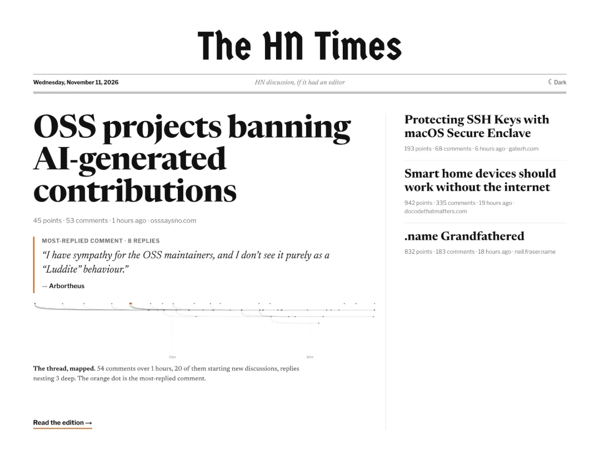

# The HN Times

[thehntimes.com](https://thehntimes.com) turns any Hacker News thread into a newspaper page, built with [OpenUI](https://www.openui.com). Swap the host on an HN link (`news.ycombinator.com/item?id=…` → `thehntimes.com/item?id=…`): a model reads the thread and writes the page in OpenUI Lang, and the browser renders it as it streams.

It's a worked example of a full OpenUI app: a custom component catalog, a generated system prompt, a streamed call to OpenUI Cloud Gateway, a renderer with a tool, and components that check what the model wrote.

<p>
  
  
</p>

## How a page gets written

```
/item?id=N ──► LiveEdition (client) ──POST /api/edition──► decide(): serve │ building │ quiet │ write
                     ▲                                                                       │
                     │  NDJSON events: thread, then text deltas, then done                   ▼
                     │                                                     writeEdition(): gather sources,
                     │                                                     one streamed Gateway call
                <Renderer> + catalog ◄──── OpenUI Lang, streamed ◄──────────────────────────┘
```

1. **[app/item/page.tsx](app/item/page.tsx)** renders a stored edition straight away if there's one. Otherwise it mounts [LiveEdition](components/paper/LiveEdition.tsx), which POSTs the story URL to [/api/edition](app/api/edition/route.ts).
2. **The route** applies the caching rules ([lib/cache.ts](lib/cache.ts), `decide()`): replay a stored edition, say the story is still building or too quiet, or write a new one.
3. **Writing** ([lib/generate.ts](lib/generate.ts), `writeEdition()`):
   - Fetch the thread from the HN Algolia API.
   - Then, in parallel: the linked article, earlier HN stories from the same site, and HN profiles of the poster and the most-replied commenters.
   - Format everything into one prompt ([lib/thread-prompt.ts](lib/thread-prompt.ts)). It has size ceilings; big threads keep their most-replied comments.
   - Make one streamed call to Gateway.
4. **Streaming.** The route sends NDJSON events: a `thread` event first (the comments the page checks quotes against), then `text` deltas of the program, then `done`. LiveEdition appends the deltas and re-renders.
5. **Storing.** The finished program is saved with a slim copy of the thread (only the comments it references) and the comment timeline for the map.

## The pattern: a model composing pages from your data

The HN Times is a model writing a page from data it didn't make. The same shape fits any page built on other people's data: a weekly digest of a repo's issues, a brief on a support queue, a report on a set of documents.

1. **Gather the data first.** The app fetches everything before the model runs: the thread, the linked article, the commenters' profiles and earlier stories ([lib/generate.ts](lib/generate.ts)). It all goes into one prompt; the model fetches nothing itself.
2. **Give the model your components, not HTML.** A catalog of newspaper parts ([library.tsx](components/paper/library.tsx)) and the house style as rules ([prompt.ts](components/paper/prompt.ts)). The system prompt is [generated](https://www.openui.com/docs/openui-lang/system-prompts) from both, and the call goes through [Gateway](https://www.openui.com/docs/gateway).
3. **Have it point at the data, not copy it.** Components take references to records: `Quote(commentId, "exact words")`, `Person(commentId, …)`, `Fact(…, commentId)`. The page holds the data, resolves every reference against it, and drops what doesn't match.
4. **Let big data skip the model.** The thread map plots every comment, but that data never passes through the model. It writes a [Query](https://www.openui.com/docs/openui-lang/queries-mutations), and the [renderer](https://www.openui.com/docs/openui-lang/renderer)'s `toolProvider` answers it from an API route ([EditionRenderer.tsx](components/paper/EditionRenderer.tsx), [/api/timeline/[id]](app/api/timeline/[id]/route.ts)).
5. **Stream the page.** The model writes the skeleton first, so the page lays out at once and fills in as it streams:

```
root = Edition([headline, map, story, sidebar, colophon])
headline = Headline("Image generation", "Images 2.6 sends developers back to their test prompts", "…")
timeline = Query("get_comment_timeline", {id: 50372945}, {comments: []})
map = ThreadMap(timeline.comments)
story = Story([lede, formats, rollback, costs, costbox, animation, closing])
formats1 = Prose("… with its explanation: {1}. …", [Quote(50373156, "The API creates a reference image and uses it to produce the SVG.")])
```

### Why references

A page that puts words in real people's mouths can't trust the model's copy: a misattributed quote is the worst thing it can print. References make every claim checkable.

The checks live in the components, so they run as the page renders, with no review step to add. A `Quote` shows only if its words are in the comment. A wrong id is repaired to the one comment that contains them, or the quote is dropped ([lib/thread.ts](lib/thread.ts)). Article quotes must be in the article; unknown ids and links are dropped. [scripts/check-edition.mjs](scripts/check-edition.mjs) runs the same checks on a saved edition.

## Caching

Model calls are the expensive part, so production caches almost everything. Development never caches.

- **Editions:**
  - not written while a story is under an hour old;
  - rewritten at most every 6 hours while it's under a day old;
  - written once more, then frozen.
- **Thresholds:** an edition needs 5+ comments and 10+ points. Once a story is a day old, it needs 100+, to cap the cost of requests for old stories.
- **One writer per story:** the first request takes a lock and writes; every other request follows the same run's events ([lib/live.ts](lib/live.ts)). Every edition is kept as a version.
- **Retiring editions:** bumping `CACHE_VERSION` in [lib/version.ts](lib/version.ts) retires every cached edition.

Storage sits behind one interface ([lib/store.ts](lib/store.ts)): a key-value store for pointers, locks and live streams, and a blob store for editions, threads and articles. It falls back to `.cache/` on disk when neither is configured.

## Running it

```bash
pnpm install
pnpm dev        # http://localhost:3000
```

Set `THESYS_API_KEY` (from [console.thesys.dev/keys](https://console.thesys.dev/keys)) for Gateway and `EXA_API_KEY` for linked articles. `MODEL` and `REASONING` optionally override the model and reasoning effort.

After changing the catalog or the rules, regenerate the spec the prompt is built from:

```bash
npx @openuidev/cli@latest generate components/paper/library.tsx --spec --out generated/library.spec.json
```

In development, every visit writes a fresh edition. Runs are saved to `runs/` and threads to `snapshots/`. Add `&replay` to an item URL to re-render the latest run without a model call.
